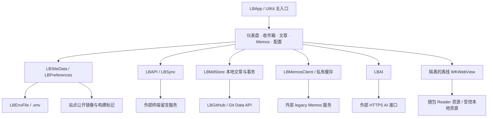

# longBlog iOS

面向 longBlog 站点维护者的原生 iOS 客户端：在手机上查看站点状态、回复终端留言、编辑与发布文章、管理 Memos，并维护站点配置。

**独立仓库：** `minlonghuo-lab/longBlog-iOS`  
**独立应用版本：** `1.0.1`（build `2`，启动修复），以原仓库 `a7b1a06` / `2.15.2` 稳定版为代码基线。独立仓库的初始版本为 1.0；不表示重新实现，也不包含已放弃的 2.15.3 改动。

1.0.1 将启动选页的凭据检查和仪表盘文章扫描移出主线程，按需创建各入口页面，并保护异常文章元数据。详见 [`docs/LAUNCH-1.0.1.md`](docs/LAUNCH-1.0.1.md)；尚未取得本次设备崩溃日志或真机冷启动耗时，不能据此宣称所有启动闪退已解决。

> 本仓库仅包含 iOS 客户端，不包含 longBlog 网站、终端留言后端、Memos 服务、部署流水线或 AI 服务。客户端能否使用某项功能，取决于对应服务与协议是否已经配置。

## 功能

应用有五个主入口，AI 写作助手为文章编辑器内置的辅助功能。

### 仪表盘

- 汇总站点文章、公开说说、终端留言会话和友链信息。
- 查看 GitHub 最新提交、线上构建标记、说说镜像心跳和部署状态。
- 查看指定域名的 TLS 证书到期信息；网络失败时显示错误或历史核验状态。

部署结果来自远端标记与提交信息的核对，不代表客户端自带构建或发布服务。

### 收件箱

- 连接 longBlog 终端留言服务，查看会话、消息与未读状态。
- 回复访客留言、查看会话联系信息、浏览归档和删除归档。
- 配合本地通知与系统后台刷新机制提示新消息。

这不是通用邮件客户端，也不是任意聊天服务客户端。通知和刷新受授权、系统调度、网络与应用状态限制，不保证实时送达或持续后台运行。

### 文章

- 本地文章列表、阅读、撰写、编辑和预览；支持 Markdown，以及显式声明的 HTML 正文格式。
- 编辑标题、正文、标签和手写摘要，插入格式、链接、表格、任务列表、提示块及附件等内容。
- 本地恢复草稿与正式保存分开处理；是否“有修改”通过实际内容快照比较，不只看是否发生过输入事件。选区、光标或预览切换本身不产生正文修改；改回原文也不会继续标为修改。
- 使用系统文件夹选择器指定文章目录，或使用默认沙盒 `Documents/Posts`。文章以带 frontmatter 的标准 `.md` 保存，按 `草稿/`、`已发布/` 与文章子目录组织，附件随文章管理。
- 从 GitHub 下载文章和附件，保留本地草稿、修改及未跟踪文件。远端删除只清理符合条件的干净镜像，不覆盖本地编辑。

#### 保存、暂存和提交

1. **保存草稿**：未发布文章先保存到本地；恢复草稿用于防止未提交编辑丢失。
2. **暂存发布 / 下架**：加入待处理列表，再在文章列表审阅并一并提交。
3. **批量提交**：基于固定 GitHub 快照创建 blobs、一个 Git tree 和一个 commit，再以 `force: false` 更新 `main`，不是逐篇覆盖远端文件。
4. **已发布文章保存修改**：编辑器有立即同步线上更新的保存路径，请先确认按钮说明与待提交列表。

更新远端分支前会持久化提交检查点，记录仓库、凭据身份代次、基线与目标提交。遇到超时或结果不明时，恢复流程通过只读查询确认是否已应用；不会因为离线恢复而自动重放发布，也不强推或自动改写远端历史。更换仓库或凭据后，未确认事务需要人工核对。

#### 撤销待提交修改

「撤销」针对确认时冻结的本地暂存选择，不是 GitHub 历史回滚：

- 先只读核验远端基线；本地内容、目录、仓库或远端 blob 已变化时拒绝继续。
- 恢复已跟踪内容前保留备份和恢复日志；未跟踪附件、侧件不作简单清空。
- 从未发布的草稿保留正文和附件，仅取消待发布状态。
- 不发送远端提交、不撤回已经发布的历史提交；中断或失败的撤销需要人工检查，不自动重放。

### Memos / 说说

- 未连接私有账号时，可读取站点提供的公开说说镜像。
- 配置兼容的 Memos 服务后，验证当前用户身份，查看时间线与详情，撰写和编辑说说，处理标签、可见性、置顶、归档及附件。
- 支持图片、音频、视频等附件的展示或原生预览/播放，具体行为取决于附件格式与本地缓存状态。
- 私有缓存按服务地址、凭据及已验证用户身份隔离；已验证绑定可用于离线读取对应缓存，不能把旧账号数据带入新账号。
- 离线只能读取已缓存内容和保存适用的本地草稿，不代表完整镜像已经下载；不会联网后自动发布离线修改。

**兼容性边界：** 实现针对 legacy Memos REST 协议，包括 `/api/v1/user/me`、`/api/v1/memo`、`/api/v1/tag` 和 `/api/v1/resource/blob` 等端点，以及数字 ID、`rowStatus`、`resourceList` 等数据结构。不能据此宣称兼容任意最新版 Memos；地址可配置不等于协议自动适配。

### 站点配置

- 读取并编辑站点 GitHub 仓库中的 `.env`，按配置分组维护站点信息与友链。
- dotenv 编辑器保留未修改行，修改项经过转义与校验后提交。
- 配置提交与文章提交是不同操作；写入 `.env` 后仍需外部站点流水线完成构建与部署。

### AI 写作辅助

- 生成摘要、润色摘要、润色选中文字或全文、从光标处续写。
- 使用可配置模型的 OpenAI-compatible Chat Completions 接口，接口地址必须是 HTTPS。
- 支持流式结果展示，预览后由用户决定是否应用，不自动替代发布决策。
- AI API Key 保存在设备 Keychain；请求会把相关标题、正文、摘要或选中文字发送给所配置的服务。请自行确认服务商的数据政策，避免提交敏感内容。

## 架构

主体是 **Objective-C + UIKit**。应用导航、列表、表单、编辑器和媒体交互由原生组件负责；WebKit 主要用于离线文章/说说格式化阅读与图表预览，不是把线上管理后台套进 WebView，也不是 Swift / SwiftUI 项目。



| 模块 | 职责 |
| --- | --- |
| `LBApp.m`、`LBNavigationController.*` | 生命周期、五入口、导航与阅读时的系统栏策略 |
| `LB.h`、`LBSite.m` | 公共接口、偏好设置、Keychain、HTTP、GitHub 访问、站点数据汇总 |
| `LBAPI.m`、`LBSync.m`、`LBInbox.m`、`LBChat.m` | 终端留言协议、会话同步、收件箱与回复 |
| `LBEnv.m`、`LBConfig.m`、`LBSettings.m` | dotenv 解析/编辑、站点配置、客户端连接设置 |
| `LBMdStore.*`、`LBPostEditor.*` | 本地文章、同步基线、暂存、提交/恢复和编辑草稿 |
| `LBPostReader.*`、`LBMarkdown.*`、`LBDiagramPreview.*` | 阅读渲染、Markdown 与图表预览 |
| `LBMemosClient.m`、`LBMemosDiskCache.*`、`LBMemos*.m` | Memos 认证、CRUD、时间线、详情、编辑与离线缓存 |
| `LBMemoMedia.*`、`LBAudioCenter.*` | 附件处理、预览与音频播放 |
| `LBAI.*` | AI 请求、流式响应和结果应用界面 |

阅读器使用随包 HTML/CSS/JS、内容安全策略、隔离的脚本世界和受控资源加载。WebView 不直接导航到任意网络页面、文件或子框架；外链与媒体交互由原生侧处理。离线指渲染资源和已有缓存可本地使用，不代表所有外链或远程附件都可离线打开。

## 仓库结构

独立仓库以当前 iOS 客户端目录为根，核心结构如下：

```text
.
├── src/                 # Objective-C 源码与头文件
├── resources/           # 图标与离线阅读器资源
│   └── Reader/          # HTML、CSS、JS 与第三方渲染资源
├── tools/               # 本地构建、资源整理和文章迁移工具
├── tests/               # 源码契约、算法/边界 fixture 与 DOM 测试
├── docs/                # 历史版本排查与审计报告
├── package.json         # 测试与离线 DOM 环境声明
└── project.yaml         # 声明式构建配置
```

不提供 `.xcodeproj` / `.xcworkspace`，不使用 Swift。`build/` 是本地产物，不作为源码依赖或提交内容。历史审计位于 `docs/history/`，用于版本追溯与技术记录。

## 配置与首次使用

在应用连接设置中按需配置各项服务；并非每项都必须同时启用。

| 配置 | 用途与要求 |
| --- | --- |
| 站点 URL | 读取公开说说镜像和线上构建信息；需符合 longBlog 的数据契约 |
| GitHub 仓库 `owner/repo` 与 Token | 读取/更新 `.env`、下载和提交文章；当前实现使用 `main` 分支 |
| 本地文章目录 | 默认沙盒目录；也可授权一个外部文件夹，首次同步前请备份已有内容 |
| 终端留言 API 地址与 Owner Key | 收件箱认证、会话和回复；地址应指向服务基路径 |
| Memos HTTPS 服务根地址与 Token | 验证账号并启用私有管理；服务根地址不附任意 API 路径 |
| AI HTTPS Base URL、模型、API Key | 可选；服务必须实现客户端所需的 Chat Completions 契约 |
| 证书监控域名 | 仅填写域名，不填写协议、端口或 URL 路径 |

GitHub 建议使用仅授权目标站点仓库、具备所需 Contents 读写权限的细粒度 Token；不要把客户端代码仓库误填为站点内容仓库。文章路径约定包括 `content/posts/` 与 `public/assets/`，站点配置位于 `.env`，不能当作通用 Git 客户端使用。

终端留言服务需要实现 `/owner/sessions`、`/owner/messages`、`/owner/reply` 及归档/联系信息等接口。公开说说镜像使用站点下的 `/api/shuoshuo-feed/snapshot.json` 和 `/api/shuoshuo-feed/version.json`。仅部署一个普通静态站点或填写任意 API URL，并不能自动获得这些功能。

Owner Key、GitHub Token、Memos Token 和 AI Key 使用设备 Keychain 保存；服务地址、模型等非秘密设置使用本地偏好。仓库中的默认地址是历史实例，不是为所有使用者提供的公共服务，应改成自己的端点并验证连接。

### 原应用覆盖与凭据连续性

当前保留 Bundle ID：

```text
com.huowenlong.longblog.inbox
```

保留标识是为了延续原应用身份及现有凭据使用路径，但**不保证跨签名团队或不同 entitlements 的 Keychain 访问连续性**。Keychain service 标识也是实现契约的一部分，不要仅为独立仓库改名而随意替换。

同 Bundle ID 的签名安装可能覆盖现有应用，而不是额外安装一个副本。覆盖前请备份文章、草稿和外部目录，核对签名团队、权限和数据迁移。删除应用、改 Bundle ID 或更换签名方式均可能改变本地数据/凭据可用性。若希望并存测试，需要显式规划新标识和隔离策略，不能照搬生产凭据。

## 构建与安装

### 构建环境

- 目标最低版本：**iOS 26.0**，arm64。
- 声明使用 `~/.ios-sdk/iPhoneOS26.5.sdk`，SDK 路径可在 `project.yaml` 调整。
- 原生编译器为 clang，链接/打包依赖外部 **Minis ios-dev buildkit**；需要 Python 3、PyYAML、相应工具链和 Apple SDK。
- `ios-dev` 工具链、SDK、签名证书、描述文件及配对材料**不随本仓库分发**。请先按工具链文档完成安装与自检。

在仓库根目录运行：

```sh
# 使用默认外部 buildkit 路径
python3 tools/build_local.py

# 或明确指定已安装的 buildkit
python3 tools/build_local.py /path/to/ios-dev/scripts/mk.py
```

脚本读取 `project.yaml`，以 ARC 编译 Objective-C 源文件；先串行编译、检查非空对象并有限重试，再调用外部 `mk.py` 链接和打包，以规避 iSH 并行编译产生空对象的问题。当前启用 `-Wall -Wextra -Werror`。

**打包成功不等于可以安装。** 基线配置 `sign.mode: adhoc` 不包含开发或分发安装所需的完整授权。安装到设备仍需匹配的签名证书、描述文件和设备条件；请使用外部工具链的签名/安装流程。不要上传 `.p12`、私钥、描述文件、配对文件、Token 或真实私有缓存。

## 测试与验收

`tests/` 包含 Python 源码契约测试、host-C / Objective-C 边界 fixture 和 Node/DOM 渲染测试。部分测试依赖 SDK、编译器或额外 DOM 环境，按测试文件及 `tests/READER-INTEGRATION.md` 等说明准备环境。

这些测试不是完整的真机端到端验证。历史 2.15.2 审计明确记录了既有基线失败/错误，**不能宣称全套全绿**。

发布前建议至少覆盖：

- 签名安装/覆盖安装、冷启动与升级后的 Keychain 和目录授权。
- 无修改退出、改回原文、输入法组合文本、Undo/Redo、恢复草稿与附件保存。
- 暂存审阅、批量提交、超时后只读确认、远端并发修改、账号/仓库切换。
- 撤销前备份、远端变化时拒绝、草稿与未跟踪附件保留。
- Memos 旧协议兼容性、身份切换、离线私有缓存边界与附件播放。
- 长文/长说说排版、原生正文到格式化阅读的交接、键盘及系统导航栏交互。
- 通知授权、后台调度受限与网络中断时的真实行为。

## 已知限制

- 当前只声明 iOS 26+；更早系统不在支持范围。
- 面向 longBlog 站点的数据布局与后端契约，不是通用 CMS、Git 客户端或任意 Memos 版本适配层。
- 文章保存、发布、站点配置提交会产生真实远端写入，请先用测试仓库和测试内容验收。
- 离线支持不等于自动同步队列，更不等于自动发布。存在未确认提交或撤销日志时，需要核对实际状态。
- 正文排版和原生/WebKit 内容交接仍需真机验证；保留 2.15.2 的既有实现，没有并入已放弃的 2.15.3 改动，不能声称排版问题已经全部解决。
- 不承诺常驻后台、实时消息推送、固定刷新间隔、所有媒体格式可用或线上部署必然成功。
- 外部 API、GitHub、AI 服务、签名与构建工具变化均可能影响使用；AI 费用由所配置服务决定。

## 来源、许可与第三方资源

本项目由 longBlog 仓库中的 `ios/LongBlogInbox` 独立而来，代码基线为 `a7b1a06` / `2.15.2`。

独立仓库由站点维护者保留权利；阅读器内第三方资源保留其原有声明与许可约束：
- **KaTeX 0.19.0**：MIT 许可证，见 `resources/Reader/vendor/KaTeX-LICENSE.txt`
- **Marked 12.0.2**：MIT 许可证，见 `resources/Reader/vendor/Marked-LICENSE.md`
- **highlight.js 11.12.0**：BSD-3-Clause 许可证，见 `resources/Reader/vendor/Highlight-LICENSE.txt`
- **Mermaid 12.2.0**：MIT / 复合开源许可证，见 `resources/Reader/vendor/Mermaid-LICENSE.txt` 及 `Mermaid-THIRD-PARTY-NOTICES.txt`
- **LXGW WenKai Screen / EB Garamond / JetBrains Mono 字体**：OFL 1.1 / MIT，见各字体目录内声明及 `SiteFonts-PROVENANCE.json`
- **Boxicons**：MIT 许可证，见 `resources/Reader/vendor/Boxicons-LICENSE.txt`
